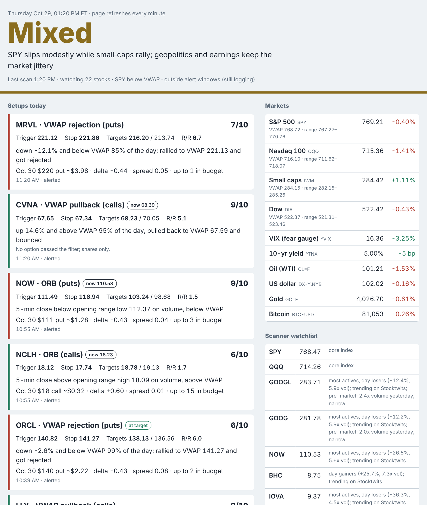
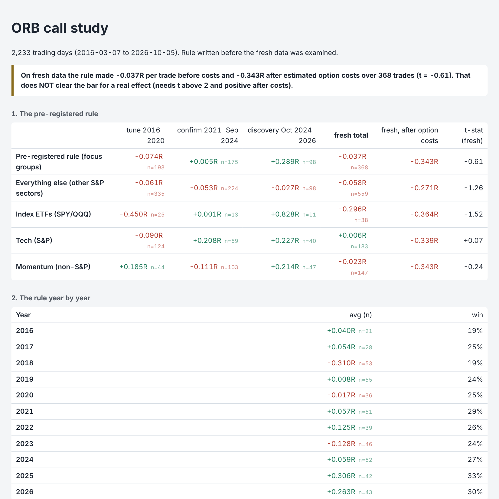

# Market desk

**A live intraday market dashboard plus the backtest harness that tested whether its own signals work. Mostly, they didn't.**

The desk runs all day. It reads 21 news feeds, writes a market read, scans ~550 stocks for four intraday setups, picks an option contract for each, and grades every signal after the close. I then replayed **10 years of 1-minute data** through the exact same detection and scoring code to find out whether any of it has an edge.

## What the backtests found

**Full scanner, 2 years (Oct 2024 – Oct 2026).** 17,050 setups were logged, and 7,799 would have alerted.

- The alerted setups averaged **+0.003R per trade**, which is no edge on the stock move.
- After estimated option costs (0.50 delta, $5 per contract round trip), **every strategy row is negative.** Tight intraday stops make the bid/ask spread a large fraction of each trade's risk.
- **The 1–10 setup score doesn't predict results.** 10s averaged +0.03R, 9s −0.03R, and 6s +0.00R.

**Pre-registered ORB study (`orb_study.py`).** Opening-range-breakout calls were the only setup positive in both halves of the 2-year test, so I wrote the rule down *before* looking at 2016–2024 and then tested it there:

- On the fresh data it made **−0.037R per trade before costs and −0.343R after option costs** (n = 368, t = −0.61).
- None of 24 variations was positive after costs in either fresh period.
- The period the idea came from looked great (SPY/QQQ +0.83R). The same rule lost 0.45R per trade in 2016–20. That's overfitting, caught by holding data out.

**Decision:** intraday alerts are not traded with options. The full reports are `daytrade_backtest.html` and `orb_study.html`. Download either one and open it in a browser.

### How the backtest avoids fooling itself

- **Same code path.** The replay calls the live `setups.detect` / `setups.score` functions, and I checked it against the live output on real days. The ORB study's faster engine reproduces the full replay's signals 301 out of 301.
- **Pessimistic fills.** If the target and stop are hit in the same minute, it counts as a loss.
- **The hypothesis comes first.** The ORB rule was written before the test data was examined. Variations were tuned on 2016–20, confirmed on 2021–24, and only then reported.
- **Costs included.** Results are shown in R, both before and after estimated option spreads.
- **Known biases, stated up front.** News and Stocktwits catalysts aren't reproduced, the universe has survivorship bias (worse further back), and option availability is assumed.

**Stack:** Python (pandas, numpy, requests, yfinance, feedparser), Alpaca 1-minute bars for history, Yahoo for live quotes, optional LLM (Gemini, Groq or Claude) for written explanations, and ntfy for phone alerts.

> Not investment advice. This is a research and learning project, and the results above are the reason it doesn't trade intraday signals.

---

# Using it

One app that runs all day on your Mac and does four jobs:

| Part | What it does | How often |
|---|---|---|
| **Catalyst alerts** | Reads 21 news feeds, pushes big market-moving headlines to your phone, and notes which stocks have news | every 45 seconds, all day |
| **Market brief** | Bullish / bearish / stable read from live prices; with an API key, Claude explains what the headlines mean | every 15 minutes, 8:30 a.m.–4:15 p.m. |
| **Setup scanner** | Scans ~550 stocks before the open, builds a 20-stock watchlist from market-wide movers, news and Stocktwits, then checks it every minute for setups and picks an option contract | watchlist every 20 min, setups every 60 s |
| **Scorecard** | Logs every setup and grades it after the close: did it hit the target or the stop first? | 4:10 p.m. daily |

Everything shows up on one page, `desk.html`, which refreshes itself every minute.

## Setup

1. Download this repo (green **Code** button → Download ZIP, or `git clone`) and put the `market_desk` folder in `~/Documents`.
2. Install the free **ntfy** app on your phone and subscribe to a long, random topic name.
3. Double-click **`1 - SETUP (double-click me first)`**. If macOS blocks it, right-click → Open → Open.
   It installs everything and runs a 2–3 minute test, then opens `config.env`.
4. In `config.env`, paste your ntfy topic and your email (`NEWS_UA`). For the backtest, add free Alpaca
   paper-trading keys (`ALPACA_KEY_ID`, `ALPACA_SECRET`). Optionally turn on AI
   explanations: free with a Gemini or Groq key, or paid with Claude. Save.
5. Double-click **`2 - RUN (double-click me)`** before 9 a.m. on trading days. Leave the window open.

## What an alert means

Setup alerts look like this:

> **IONQ · Higher-low hook (calls) · 7/10**
> Trigger 45.49 · stop 44.90 · targets 46.00 / 46.80 · R/R 1.9
> Oct 02 $45 call ~$1.94 (delta +0.55, vol 2,254), up to 2 contracts in budget
> Context: SPY above VWAP; 1.9x normal volume

It means the rules found the pattern on data that is about a minute old. **Check your own chart
before entering.** "No contract passes the filter" means the options are too wide, too thin, or over
budget: trade shares or skip.

## The four setups (each has a call and a put version)

- **ORB:** a 5-minute close outside the 9:30–9:45 range on above-normal volume, on the right side of VWAP (until 11:00).
- **VWAP pullback / rejection:** a stock trending all day pulls back to VWAP, holds, and bounces.
- **Prior-day high / low break:** yesterday's level breaks on 2x+ volume.
- **Higher-low hook / lower-high rollover:** the BB pattern: a higher low, 1-minute RSI turning up
  from 30–42, and a strong candle.

Every setup must offer at least 1.5:1 reward to risk. Scores run 1–10: points for agreeing with
the market read and SPY's side of VWAP, heavy volume, a news catalyst, a good R/R, and a usable
option contract; big deductions for fighting the market. Only 6+ inside the alert windows
(9:45–11:30 and 1:30–3:30 by default) reach your phone; everything else is logged for the scorecard.

## The scorecard

After each close, every logged setup is graded:
**win** = target 1 hit before the stop, **loss** = stop hit first (a same-minute tie counts as a
loss), **timeout** = neither by the close, scored at the closing price. Results are in R (multiples
of the risk), so a win at 2:1 is +2R and a loss is −1R.

Give it at least 3–4 weeks and 30+ graded setups before trusting any win rate. Then use it:
drop setups or time windows with negative average R, and raise `MIN_ALERT_SCORE` if alerts are noisy.

## Tuning

All the trading rules live in `config.env`: budget, alert score, R/R, delta range, spread limit,
price/volume/market-cap floors, the 0DTE cutoff and the alert windows. Edit popular extra stocks in
`universe.py` (`EXTRAS`) and news keywords in `sources.py`.

## AI explanations and cost

The written brief and headline second opinions use whichever AI provider you set in `config.env`
(the switch lives in `llm.py`):

- **Gemini (free):** key from aistudio.google.com, no billing enabled. Set the brief to every 30
  minutes to stay inside the free daily limits.
- **Groq (free):** key from console.groq.com. Also best at every 30 minutes.
- **Claude (paid):** roughly $10–15/month for a Sonnet 5 brief every 15 minutes, about half that on
  Haiku or every 30 minutes.
- **None:** free, rules-only. Everything except the written explanations still works.

If a provider hits its limit or returns something unreadable, the app pauses AI for 10 minutes and
falls back to the rules, so nothing breaks.

## Limits

- Free data runs about a minute behind your broker, and Yahoo can rate-limit heavy use. If a scan
  fails, it retries the next minute.
- Market holidays aren't detected; the app just finds no data that day.
- It only works while the Mac is awake with the window open.
- The setups and scores are screens, not predictions. The scorecard is how you find out whether
  they work.

## Files

`desk.py` runs everything · `news_engine.py` alerts · `market_brief.py` market read ·
`discovery.py` watchlist · `setups.py` patterns · `contracts.py` option picker ·
`journal.py` scorecard · `dashboard.py` the page · `sources.py` feeds · `universe.py` stock list ·
`swing.py` swing trades · `llm.py` AI provider switch · `history.py` 1-minute history download (Alpaca) ·
`daytrade_bt.py` full backtest · `orb_study.py` pre-registered ORB study · `state/` saved data (delete it to start fresh).

## Swing trades (30-60 DTE options)

A separate, slower system on daily charts, with position sizing driven by a configurable account size (`SWING_ACCOUNT`). It runs once a day at 10:00 a.m.
ET in the background and shows the top 1-3 trades (or **NO TRADE**) on the desk page, and pushes the top one to your phone.

**Process (stock first, option second):** market regime (SPY/QQQ vs 50/200-day averages, IWM, VIX,
breadth) → sector ranks → four setups on ~550 stocks → stock score → earnings check → option chain →
option score → final score (60% stock, 40% option) → position size → top 3, max one per sector and direction.

**Setups:** bullish pullback (calls), breakout (calls), bearish breakdown (puts), bearish rally rejection (puts).
Signals use completed daily bars only, and a setup is dropped if price has already moved more than half an ATR past the signal close.

**Linear regression:** a 50-day regression line through log price gives the trend's slope, its R²
(how cleanly it trends) and how many standard deviations price sits from the line. These feed the
trend and setup scores. Separately, a ridge regression trained on the backtest predicts each setup's
R-multiple. It is tested on the most recent 30% of history it never saw, and that test result is printed next to every prediction.

**Rules enforced:** no trade unless stock score ≥ 80 and option score ≥ 75; 0.55-0.75 delta; 30-60 DTE
preferred (75 max); bid/ask ≤ 10% of mid (≤ 5% preferred); earnings inside the holding period → skipped
with EARNINGS RISK; risk 15% / 10% / 5% of the account for A+ / A / B grades, never above 20%; contracts
rounded down, and if one contract doesn't fit, no trade. Debit spreads are allowed because most 0.55+ delta
single options often cost more than the per-trade risk limit allows. A setup whose backtest shows negative expected value for the option is never a top trade.

**Win rates:** only from the 5-year backtest (stock level: target before stop within 15 trading days,
stop checked first on the same bar). Fewer than 30 matching signals → "Win rate not validated". The
backtest only covers stocks in today's indexes (survivorship bias), so treat it as optimistic for calls.
IV percentile needs 60 days of recorded IV; until then the page shows IV vs 20-day realized volatility.

**Tracking:** every pick is paper-traded in `state/swing.db` until its stock target, stop, 15-day
timeout, or the day before earnings, with the option marked daily. Near-misses (stock qualified, option
didn't) are tracked at the stock level. If you actually take one:

    python swing.py take 7 1.25 1     # you bought pick #7 at $1.25, 1 contract
    python swing.py close 7 1.90      # you sold it at $1.90

Other commands: `python swing.py scan` (scan now), `backtest`, `update`, `report`. Run them from the
folder after `source .venv/bin/activate`. All settings start with `SWING_` in `config.env`.
